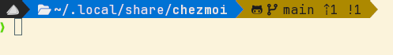
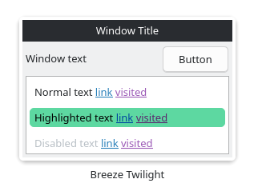
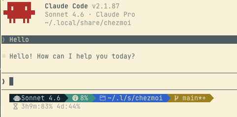

# My Dot Files

[Chezmoi](https://www.chezmoi.io/) managed dotfiles for my development environment.

## What's Managed

### Shell — Zsh
- Environment variables (`~/.zshenv`)
- Modular config loaded via [antidote](https://getantidote.github.io/) plugin manager
- Plugins: powerlevel10k prompt, zsh-autosuggestions, zsh-completions
- Aliases: `ls` → eza, `ll` → eza detailed listing
- Integrations: zoxide (smart `cd`), fzf (fuzzy finder), ghostty shell integration



### Terminal — Ghostty
- Shell integration with zsh
- Light/dark Selenized theme
- Keybindings for split creation and navigation

### Desktop — KDE Plasma (Linux, optional)
Only installed when `kde = true` (prompted on Linux during `chezmoi init`, always off on macOS).

- **Breeze Twilight** colour scheme — light windows with dark headers and panels; unfocused windows get a darker header so focus is easy to see
- **Breeze-Twilight GTK theme** — Breeze plus fixes so headerbar buttons in GTK3 apps (e.g. Firefox, CachyOS Hello) stay readable on the dark header
- A run-on-change script applies both, and re-runs whenever either file changes



### Editor — Neovim
Lua-based config using [lazy.nvim](https://github.com/folke/lazy.nvim).

### Claude Code
- Global `CLAUDE.md` instructions template
- Custom status line scripts
- Settings, agents, commands, and skills directories



### Packages
A run-on-change script installs system packages via `pacman`/`yay` on Linux or `brew` on macOS:

- **neovim** — editor
- **ghostty** — terminal
- **zsh** + **zsh-antidote** — shell and plugin manager
- **mise** — runtime version manager
- **eza** — modern `ls`
- **fd** — fast file finder
- **fzf** — fuzzy finder
- **ripgrep** — fast grep
- **zoxide** — smart directory jumping
- **gh** — GitHub CLI
- **jq** — JSON processor
- **bitwarden-cli** — password manager CLI
- **wl-clipboard** — Wayland clipboard tools (Linux only)
- **Monaspace Nerd Font** — font

On first install it also offers to change your default shell to zsh.

### Git
- Global config (name, email, rebase, prune, etc.) applied via configure script
- Global `.gitignore` at `~/.gitignore_global` covering `.DS_Store`, swap files, `.env`, logs

## Setup

```sh
chezmoi init --apply git@github.com:aaron-edwards/dotfiles.git
```

On first init, chezmoi asks:
- **Machine type** — `p` (personal) or `w` (work); work also asks for your email and Git username
- **Install KDE Plasma theming** — Linux only

Answers are saved to `~/.config/chezmoi/chezmoi.toml`. To change one later, edit that file or re-run init with the new answer, e.g. `chezmoi init --promptBool "Install KDE Plasma theming=false"`.

On first apply, chezmoi will:
1. Install system packages
2. Apply git and macOS configuration
3. Bootstrap Neovim plugins (lazy.nvim)
4. Apply the KDE colour scheme and GTK theme (if enabled)
5. Print a checklist of remaining manual steps

## How It Works

- **Templates** (`.tmpl` files) handle OS- and machine-specific config
- **`private_` prefix** marks sensitive files for chezmoi encryption
- **`run_onchange_before_`** scripts run only when their content changes
- **`run_onchange_after_`** scripts run after files are applied, when their content changes — the KDE script embeds hashes of the colour scheme and GTK theme so it re-runs when either changes
- **`run_once_after_`** scripts run once on a new machine (bootstrapping)
- **`.chezmoiignore`** is a template, so files are skipped based on options like `kde`

The KDE script needs a running Plasma session; when run without one (e.g. over SSH) it skips itself. Changing the colour scheme or accent in System Settings also resets the dark inactive header, because Plasma skips that group. In either case, re-apply with:

```sh
chezmoi execute-template < "$(chezmoi source-path)/.chezmoiscripts/run_onchange_after_50_apply-kde-theme.sh.tmpl" | bash
```
